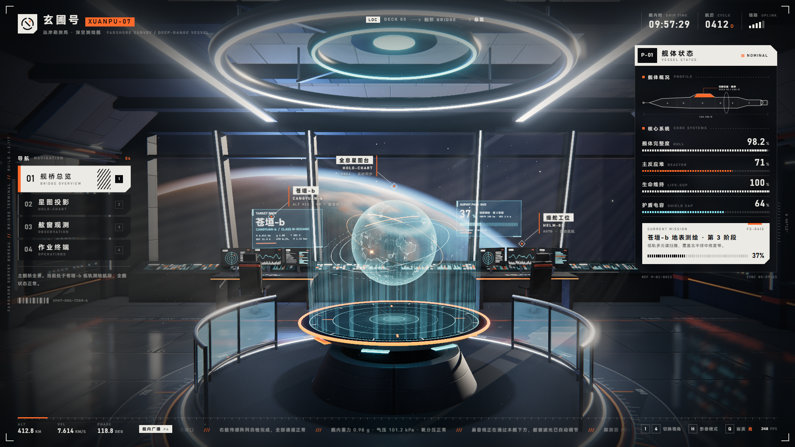
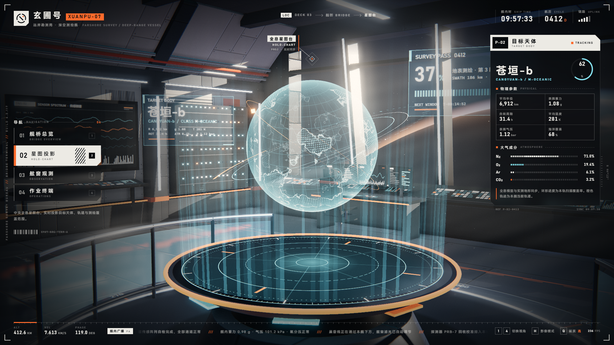
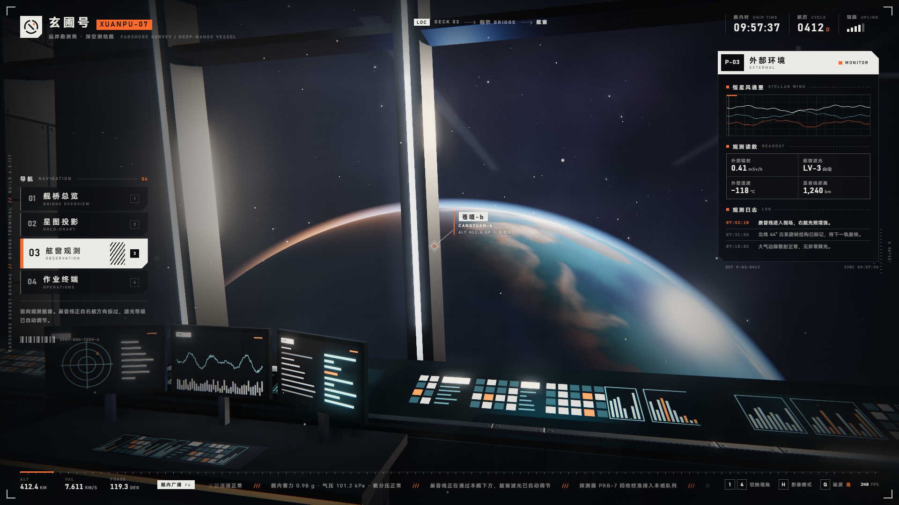
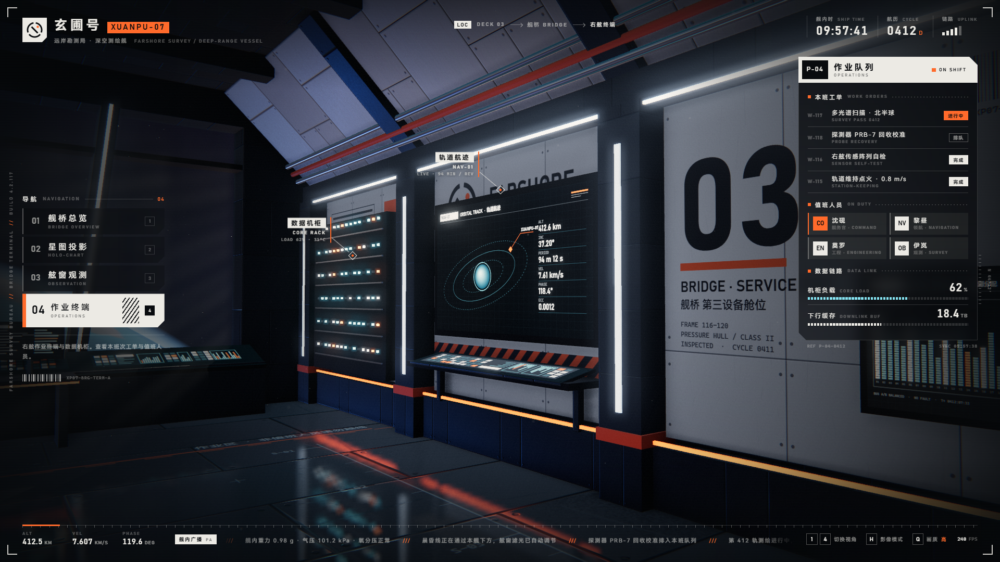

# 玄圃号舰桥 / XUANPU-07 Bridge

一个小体量的工业科幻飞船舰桥场景，用 Three.js 实时渲染，配一套战术终端风格的界面。
场景、舰名、组织与界面均为原创设定；所有贴图和模型都由代码程序化生成，没有外部美术资源。



| 星图投影 | 舷窗观测 | 作业终端 |
|---|---|---|
|  |  |  |

## 运行

需要 Node.js 18 以上。

```bash
npm install
npm start
```

然后打开 http://localhost:5173 。

## 操作

| 按键 | 作用 |
|---|---|
| `1`–`4` | 切换机位：舰桥总览 / 星图投影 / 舷窗观测 / 作业终端 |
| `H` | 影像模式（隐藏界面） |
| `Q` | 切换画质 高 / 中 / 低 |

启动时会测速并自动选择画质档位。也可以在网址后加 `?q=0`、`?q=1`、`?q=2` 强制指定高、中、低。

## 显卡

在双显卡笔记本上，浏览器可能默认使用集成显卡。在 Windows 的
设置 → 系统 → 屏幕 → 显示卡 中把浏览器设为"高性能"，然后在 `chrome://gpu` 确认。

## 结构

- `src/scene.js`：场景、材质、着色器与后期处理
- `src/textures.js`：程序化贴图
- `src/ui.js`、`style.css`：界面
- `serve.mjs`：零依赖静态服务器
